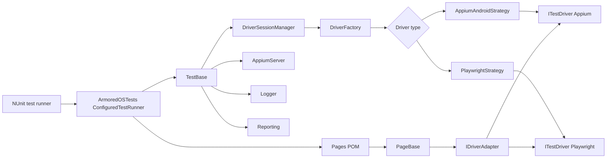
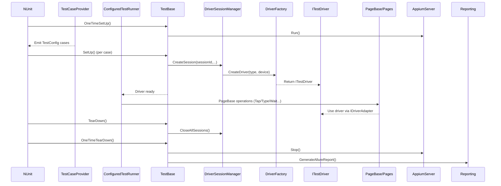
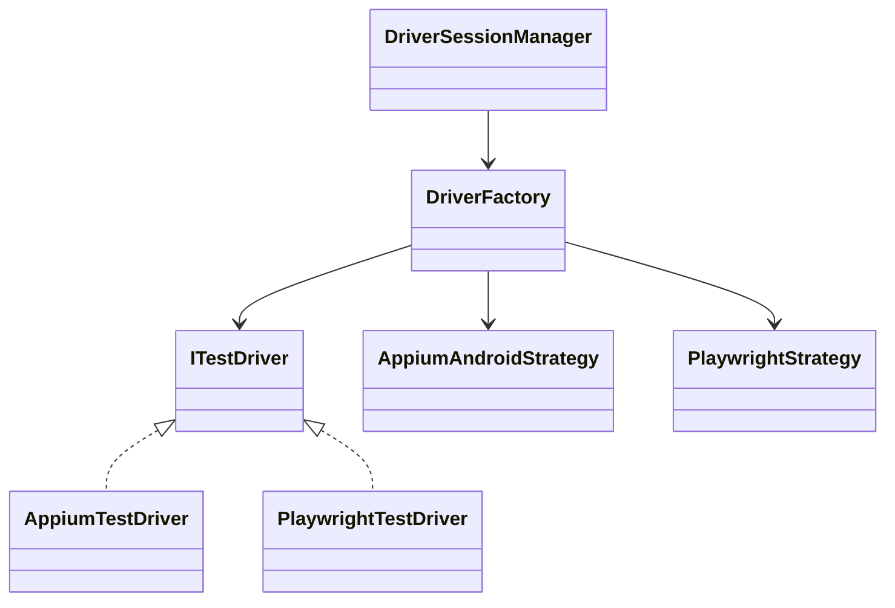
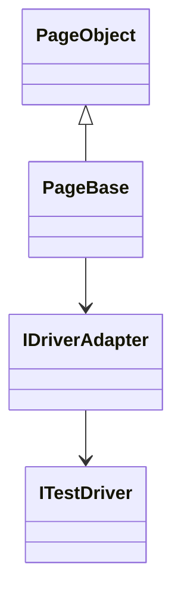

# ArmoredOSAutomation Documentation

## Table of Contents

- [1) Overview](#1-overview)
- [2) Architecture at a glance](#2-architecture-at-a-glance)
  - [Design intent](#design-intent)
- [3) Solution projects and responsibilities](#3-solution-projects-and-responsibilities)
- [4) Detailed test lifecycle](#4-detailed-test-lifecycle)
  - [Call order (what runs and when)](#call-order-what-runs-and-when)
  - [What "session" means in this framework](#what-session-means-in-this-framework)
- [5) Dependency and class relationship details](#5-dependency-and-class-relationship-details)
  - [Core abstractions (contracts you build on)](#core-abstractions-contracts-you-build-on)
  - [Driver stack relationships](#driver-stack-relationships)
  - [Page stack relationships](#page-stack-relationships)
  - [Where inheritance happens](#where-inheritance-happens)
- [6) Configuration model (deep dive)](#6-configuration-model-deep-dive)
  - [Config loading chain](#config-loading-chain)
  - [Practical field behavior (`TestConfig`)](#practical-field-behavior-testconfig)
- [7) Dependencies and tooling](#7-dependencies-and-tooling)
  - [Main NuGet groups](#main-nuget-groups)
  - [System/tool prerequisites](#systemtool-prerequisites)
  - [Recommended install commands (Windows PowerShell)](#recommended-install-commands-windows-powershell)
  - [Device setup prerequisites](#device-setup-prerequisites)
- [8) User guide: setup and running tests](#8-user-guide-setup-and-running-tests)
  - [First-time environment setup](#first-time-environment-setup)
  - [Fast validation commands](#fast-validation-commands)
  - [Run all configured tests](#run-all-configured-tests)
  - [Run specific scenario](#run-specific-scenario)
  - [Run by category/name strategy](#run-by-categoryname-strategy)
  - [Manual Appium server start (if needed)](#manual-appium-server-start-if-needed)
- [8.1) ArmoredOS-specific device bootstrap](#81-armoredos-specific-device-bootstrap)
- [9) Authoring guide: adding new automation](#9-authoring-guide-adding-new-automation)
- [10) Logging, diagnostics, and reporting](#10-logging-diagnostics-and-reporting)
- [11) Known behaviors and design caveats](#11-known-behaviors-and-design-caveats)
- [12) Troubleshooting matrix](#12-troubleshooting-matrix)
- [13) Recommended best practices](#13-recommended-best-practices)
- [14) Quick start checklist for new team members](#14-quick-start-checklist-for-new-team-members)
- [15) Maintainer notes](#15-maintainer-notes)

## 1) Overview

`ArmoredOSAutomation` is a .NET test automation framework for Armored OS validation on Android devices.

It combines:

- **NUnit** for test lifecycle and execution.
- **Appium** for mobile/native UI automation.
- **Playwright** for browser/web scenarios.
- **Page Object Model** for readable business flows and maintainable locators.

Tests are **data-driven** and executed via a dynamic dispatcher that resolves test methods from JSON configuration.

---

## 2) Architecture at a glance

This diagram shows the collaboration model during a typical test run (what interacts with what).




### Design intent

- `TestBase` owns the framework lifecycle (setup/teardown + diagnostics).
- `DriverSessionManager` owns session state and switching by session id.
- `DriverFactory` + strategies create the correct `ITestDriver` implementation.
- `Pages` delegate low-level driver operations to `PageBase`/`IDriverAdapter` so tests stay readable.

---

## 3) Solution projects and responsibilities

## `ArmoredOSTests`

- Contains test implementations organized by feature folders.
- Uses a partial `ConfiguredTestRunner` class where each file contributes test methods.
- Recommended namespace: `ArmoredOSTests.ConfigDriven`.
- Main entrypoint method: `RunConfiguredTest(TestConfig cfg)` resolves and invokes target test by name through reflection.
- Common project convention: each test method is decorated with `[AllureSuite(...)]`, `[AllureDescription(...)]` and `[Author(...)]`.
- Common naming convention: method names end with `Test` (for readability and consistency in reports/config).

## `TestBase`

- Abstract base class for all tests.
- Owns setup/teardown pipeline and shared runtime resources:
  - logger lifecycle
  - Appium server lifecycle
  - driver session lifecycle
  - failure screenshot capture
  - report generation

## `Pages`

- Page Object layer (`*Page.cs`) + selector layer (`*Path.cs`).
- `PageBase` centralizes common operations:
  - tap/type/read visibility
  - waits and retries
  - navigation actions
  - adapter-driven cross-driver calls
- Locator authoring guidance: 
  - For mobile use Appium Inspector and prefer `accessibility id` locators when possible; use Android UIAutomator/XPath only when needed.
  - For web use if possible use unique IDs or stable CSS selectors; avoid brittle XPaths.
- Organization convention: each page object has its own folder, with subfolders when feature complexity grows.

## `Automation.Drivers`

- Driver abstractions and concrete wrappers.
- `DriverFactory` maps enum to strategy and creates `ITestDriver`.
- `DriverSessionManager` supports create/switch/close/recreate behavior.
- Includes adapter/helper layers for element actions and waits.

## `AppiumService`

- Starts/stops Appium local service with required security flags:
  - `--relaxed-security`
  - `--allow-insecure=adb_shell`

## `DTO`

- Data contracts for configuration and runtime parameters:
  - `TestConfig`
  - `TestRunConfig`
  - device DTOs

## `TestSupport`

- Common constants and helpers used across projects:
  - config paths
  - adb constants
  - suite parser/provider (`TestCaseProvider`)

## `Logger`

- Serilog-based logging abstraction used by test runtime and utility modules.

## `Reporting`

- Allure report generation integration.

## `Exceptions`

- Safer execution wrappers and framework-specific exception paths.

## `PlaywrightBrowserManager`

- Browser download and support utilities for Playwright-based flows.

---

## 4) Detailed test lifecycle

### Call order (what runs and when)

1. `OneTimeSetUp` (once per fixture): initializes logger, creates `DriverSessionManager`, starts Appium (`AppiumServer.Run()`).
2. `TestCaseProvider` (discovery/runtime): reads suite JSON from `Resources` and produces `TestConfig` cases.
3. `SetUp` (before each test): loads device config, decides driver type, creates the driver session (`DriverSessionManager.CreateSession`).
4. `RunDynamicTest` executes the configured method via reflection (`TestMethodInvoker.InvokeByName`).
5. The target test method runs business steps using page objects constructed with `Driver`.
6. `TearDown` (after each test): if failed, captures screenshots for all active sessions; closes sessions.
7. `OneTimeTearDown` (once per fixture): closes all sessions, stops Appium, generates Allure report, deletes empty logs.



### How to read this call-order diagram

- Read top to bottom: time flows from suite start to suite end.
- Each vertical lane is a component (`NUnit`, `TestBase`, `DriverSessionManager`, `DriverFactory`, page layer, reporting).
- `->>` arrows show active calls.
- `-->>` arrows show returned output/ready state.
- Start boundary is `OneTimeSetUp`; end boundary is `OneTimeTearDown`.

### What you should understand from it

- `TestBase` orchestrates lifecycle, setup, teardown, and diagnostics.
- Driver creation path is `TestBase` -> `DriverSessionManager` -> `DriverFactory` -> `ITestDriver`.
- Test logic runs through page objects (`ConfiguredTestRunner` -> `PageBase/Pages`) instead of direct raw-driver steps.
- Cleanup and reporting happen at deterministic lifecycle stages.
- Debug quickly by stage:
  - setup issue -> `SetUp`, session manager, factory/strategy
  - interaction issue -> page methods, adapter, locators
  - end-of-run issue -> teardown/reporting


### What “session” means in this framework

- A **session id** is the key in `DriverSessionManager` and maps to a concrete `ITestDriver` instance.
- Tests use `TestBase.Driver` to access the *current* session via `driverSessionManager.GetCurrentSession()`.

---

## 5) Dependency and class relationship details

Here are the key relationships that matter when you extend the framework.

### Core abstractions (contracts you build on)

- `ITestDriver`: minimal lifecycle contract implemented by Appium/Playwright wrappers.
- `DriverFactory`: central mapping from `DriversType` to concrete driver strategies.
- `DriverSessionManager`: stores active `ITestDriver` sessions and supports switching.
- `PageBase`: base class for all page objects; exposes the normalized actions used by tests.
- `IDriverAdapter`: translates `PageBase` calls into driver-specific interactions.

### Driver stack relationships




### Page stack relationships




### Where inheritance happens

- `ConfiguredTestRunner` inherits `TestBase`.
- Every `*Page.cs` class inherits `PageBase` and uses the shared `Driver` property from `TestBase`.

---

## 6) Configuration model (deep dive)

### Config loading chain

1. `Resources/TestConfig.json` is loaded by `TestCaseProvider`.
2. It points to suite file name (`TestSuiteName`).
3. Suite file contains list of `TestConfig` entries.
4. Device fallback loaded from `Resources/DefaultDeviceSettings.json`.
5. Device-specific capabilities are loaded from `Resources/<Device>.json`.

### Practical field behavior (`TestConfig`)

- `TestName`: full identifier; method part is extracted and invoked.
- `IsAppium` + `IsPlaywright`:
  - both true => Appium primary session, Playwright can be created on-demand.
  - only Playwright true => Playwright session.
  - default => Appium.
- `Device`: chosen device profile; if empty, default device is used.
- `IsMDMEnabled`: affects navigation behavior on some pages.
- `ApplicationName`, `NetworkName`, `UssdCode`: test-specific parameters.

### Example suite pointer file (`Resources/TestConfig.json`)

```json
{
  "TestSuiteName": "TestConfigMDM.json"
}
```

### Example suite content (`Resources/TestConfigMDM.json`)

```json
{
  "TestConfig": [
    {
      "TestName": "ArmoredOSTests.ConfigDriven.ConfiguredTestRunner.AirplaneModeTest",
      "Device": "Pixel8a",
      "IsAppium": true
    },
    {
      "TestName": "ArmoredOSTests.ConfigDriven.ConfiguredTestRunner.PlaywrightTest",
      "IsPlaywright": true
    }
  ]
}
```

---

## 7) Dependencies and tooling

## Main NuGet groups

- **Test framework**: `NUnit`, `Microsoft.Net.Test.Sdk`, `NUnit3TestAdapter`.
- **Reporting**: `Allure.NUnit`.
- **Mobile automation**: `Appium.WebDriver`, `Selenium.WebDriver`, wait helpers.
- **Web automation**: `Microsoft.Playwright`, `Microsoft.Playwright.NUnit`.
- **Support**: `Newtonsoft.Json`, `Serilog` and sinks/enrichers.

## System/tool prerequisites

- Visual Studio 2022 (or newer version).
- Node.js and npm.
- Appium 2.x + UIAutomator2 driver.
- Java JDK (`JAVA_HOME` set).
- Android SDK/ADB (`ANDROID_HOME` set).
- Optional: Allure CLI for local report rendering.

## Recommended install commands (Windows PowerShell)

```powershell
npm i --location=global appium
appium driver install uiautomator2
```

## Device setup prerequisites

- USB debugging enabled.
- Device visible in `adb devices`.
- Armored OS-specific firewall/VPN policy requirements prepared (as per framework requirements).

---

## 8) User guide: setup and running tests

### First-time environment setup

1. Clone repository.
2. Install dependencies and tools.
3. Open `ArmoredOSAutomation.sln` and restore packages.
4. Verify Appium and ADB from terminal.
5. Ensure device is connected and authorized.

### Fast validation commands

```powershell
adb devices
appium -v
dotnet --info
```

### Run all configured tests

```powershell
dotnet test .\ArmoredOSAutomation.sln --settings .\test.runsettings
```

### Run specific scenario

```powershell
dotnet test .\ArmoredOSAutomation.sln --filter "(FullyQualifiedName~AirplaneModeTest)"
```

### Run by category/name strategy

- Organize filters by method naming conventions and namespaces.
- Keep tests uniquely named to avoid ambiguous method resolution.

### Manual Appium server start (if needed)

If you run Appium manually outside the framework:

```powershell
appium --relaxed-security --allow-insecure=adb_shell
```

---

## 8.1) ArmoredOS-specific device bootstrap

These commands are important for environments where ArmoredOS restrictions block automation actions.
In this framework, equivalent setup logic is expected to run automatically before tests.

### Enable APK install-related properties

```powershell
adb shell "su 0 setprop persist.disable_install_time_fsverity_check true"

```

### Disable firewall policies

```powershell
adb shell "su 0 iptables -P INPUT ACCEPT"

```

### Disable VPN lockdown policy

```powershell
adb shell ""
```

### Important operational note

After each device reboot, firewall/VPN restrictions can be re-enabled by OS policy. Re-apply the required setup before running tests.

### Useful ADB helper commands

List packages matching Protelion namespace:

```powershell
adb shell pm list packages | Select-String "com."
```

Launch a package/activity directly:

```powershell
adb shell am start -n com.
```

---

## 9) Authoring guide: adding new automation

## A) Add a new page object

1. Create `Pages/<Feature>/Path/<Feature>Path.cs` with locators.
2. Create `Pages/<Feature>/Page/<Feature>Page.cs` inheriting `PageBase`.
3. Add business-level methods (`EnableX`, `OpenY`, `VerifyZ`), not low-level script logic.

### Recommended method style

- action method: does one UI action, logs intent.
- state method: returns boolean/text state.
- assertion remains in test layer (`ArmoredOSTests`), not inside page methods.

## B) Add a new test

1. Create file in `ArmoredOSTests/<Feature>/`.
2. Extend `public partial class ConfiguredTestRunner`.
3. Implement method signature `MyScenarioTest(TestConfig param)`.
4. Use page objects and assertions.
5. Add entry to suite JSON file.

## C) Add new driver type

1. Implement strategy under `Automation.Drivers/Strategy`.
2. Implement/extend wrapper implementing `ITestDriver`.
3. Register enum + strategy mapping in `DriverFactory`.
4. Add adapter support where needed.
5. Update session creation logic in `DriverSessionManager` if special behavior is required.

---

## 10) Logging, diagnostics, and reporting

### Logging

- Info/debug logs are written through `Logger` abstraction.
- Logs track lifecycle events, steps, and error details.

### Failure artifacts

- On test failure, screenshot capture is attempted for each active session.
- Attachments are pushed into Allure via `AllureApi.AddAttachment`.

### Reporting

- Allure report generation is executed in suite teardown.
- Ensure Allure CLI is available if you want local interactive report rendering.

### Useful operational checks

- Verify Appium service state before long runs.
- Watch for stale sessions after interrupted executions.
- Ensure report generation process has file access permissions.

---

## 11) Known behaviors and design caveats

- Dynamic test invocation uses reflection by method name; method naming must stay stable.
- `ITestDriver` currently uses `Quite()` (legacy naming kept for compatibility).
- Appium service path resolution expects global npm install locations.
- Some cleanup paths include retry/sleep safeguards for transient lock issues.

---

## 12) Troubleshooting matrix


| Symptom                         | Likely reason                           | What to check                                              |
| ------------------------------- | --------------------------------------- | ---------------------------------------------------------- |
| Appium does not start           | Missing Appium install or path mismatch | `appium -v`, npm global location, server logs              |
| Test not discovered             | Config chain invalid                    | `Resources/TestConfig.json`, suite filename, JSON validity |
| Method not found                | `TestName` mismatch                     | Fully qualified method naming in JSON                      |
| Device setup fails              | ADB/device issue                        | USB debug auth, `adb devices`, device state                |
| Locator failures                | UI changed                              | update corresponding `*Path.cs` selectors                  |
| Playwright test fails to launch | Browser/runtime missing                 | Playwright package/install and environment                 |


---

## 13) Recommended best practices

- Keep page methods small, deterministic, and reusable.
- Do not embed hard-coded sleeps in tests unless unavoidable; prefer wait helpers.
- Keep selectors stable and centralized in path files.
- Encode business scenario in tests, technical details in page/driver layers.
- Prefer explicit assertions and clear failure messages.
- Keep configuration files under version control and validated in reviews.

---

## 14) Quick start checklist for new team members

1. Install tools and verify environment variables.
2. Run a single known stable test first.
3. Open `TestBase`, `DriverSessionManager`, and one feature page to understand flow.
4. Add one small test using existing page object methods.
5. Confirm logs, screenshot on failure, and Allure report generation.

---

## 15) Maintainer notes

- If you refactor method names in `ConfiguredTestRunner`, update suite JSON entries accordingly.
- If you introduce new config fields, extend DTOs and ensure backward compatibility.
- If changing driver lifecycle, re-check screenshot and teardown safety behavior.
- Keep this document updated whenever architecture or execution pipeline changes.

