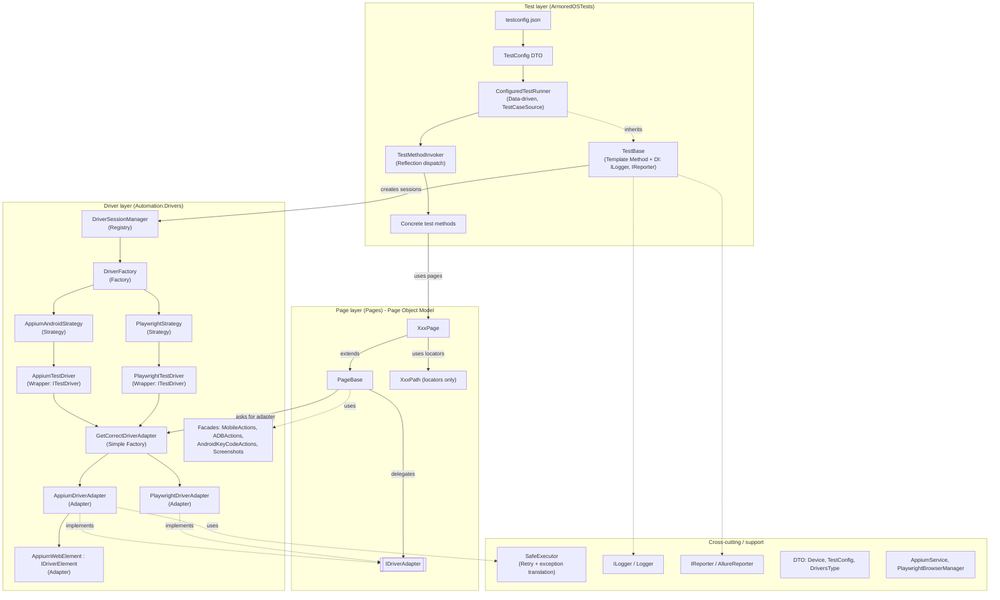

# Design Patterns in ArmoredOSAutomation

This document explains the design patterns used in the framework and how they fit together.
It is based on a review of the core driver, strategy, adapter, session, page-base and runner code.
`TestBase`, the Allure reporter and the JSON-driven config were reviewed by name and structure only.

## Contents

1. [Pattern catalogue](#1-pattern-catalogue)
2. [How the patterns fit together](#2-how-the-patterns-fit-together)
3. [One test run, step by step](#3-one-test-run-step-by-step)
4. [Where patterns are only partly applied](#4-where-patterns-are-only-partly-applied)

---

## 1) Pattern catalogue

### 1.1 Page Object Model (POM)

**Idea:** each screen gets a class that hides how to find and use its elements, so tests read as
business steps and a UI change is fixed in one place.

**In this repo:** each screen is split into a `Page` and a `Path` class
(`Pages/Appium/<Feature>/Page/` and `.../Path/`).

```csharp
// Path: locators only
internal class CalculatorPath {
    internal static string FormulaField => "new UiSelector().resourceId(\"...:id/formula\")";
}
// Page: behaviour only
public class CalculatorPage(ITestDriver driver) : PageBase(driver) {
    public string GetFormulaText() => GetElementText(CalculatorPath.FormulaField);
}
```

- `Path` classes are `internal`, so tests cannot use raw locators.
- `PageBase` supplies shared helpers (`Tap`, `ClearText`, `Back`, `GoToHome`).
- A locator change touches only the `Path` file.

### 1.2 Adapter

**Idea:** convert one interface into another that the client expects, so incompatible things are interchangeable.

**In this repo:**
- `IDriverAdapter` is the engine-neutral interface used by pages (`Tap`, `FindElement`, `Swipe`, `StartActivity`, ...).
- `AppiumDriverAdapter` and `PlaywrightDriverAdapter` translate those calls to engine-specific ones.
- `IDriverElement` / `AppiumWebElement` do the same for elements, replacing Selenium's `IWebElement`.

`PageBase` never knows whether Appium or Playwright is underneath.

### 1.3 Strategy

**Idea:** put interchangeable algorithms behind one interface and choose one at runtime.

**In this repo:** `IDriverStrategy` is implemented by `AppiumAndroidStrategy` and `PlaywrightStrategy`.
Each knows how to build its own driver. The Android strategy configures `AppiumOptions`
(UDID, PIN unlock, timeouts) and retries once on `WebDriverException`.

Adding a new platform means adding a strategy class and one dictionary entry.

### 1.4 Factory (Simple Factory / Factory Method)

**Idea:** centralise object creation so callers do not use `new` on concrete types.

**In this repo:**
- `DriverFactory` holds `Dictionary<DriversType, Func<IDriverStrategy>>` and returns the chosen
  strategy's driver, or throws `NotSupportedException` for an unknown type.
- `IDriverFactory` (with `AppiumDriverFactory` and `PlaywrightDriverFactory`) is the abstraction for tests.
- `GetCorrectDriverAdapter.GetDriverAdapterType()` is a second, simpler factory that picks the adapter.

### 1.5 Wrapper and Facade

**Wrapper:** `ITestDriver` has `AppiumTestDriver` and `PlaywrightTestDriver` implementations that wrap the
raw `AndroidDriver` / Playwright objects. This isolates the framework from library API changes.

**Facade:** `MobileActions`, `ADBActions`, `AndroidKeyCodeActions` and `Screenshots` hide ADB commands,
key codes and capture logic behind simple methods such as `GoToHome` and `Back`.

### 1.6 Template Method (base classes)

**Idea:** a base class fixes the order of a procedure and subclasses fill in the details.

**In this repo:** the abstract `TestBase(ILogger, IReporter)` owns the lifecycle (setup, teardown, driver
start and stop) and shared state such as `DeviceInfo`. Tests inherit it and add only their steps.
`PageBase` plays the same role for pages.

### 1.7 Data-driven testing with dynamic dispatch (Command-style + reflection)

**Idea:** the test list lives in data, and a runner turns each data row into an action.

**In this repo:**
- `testconfig.json` becomes `TestConfig` objects.
- `[TestCaseSource(... GetTestConfigs)]` makes NUnit run `RunConfiguredTest(cfg)` once per entry.
- `TestMethodInvoker.InvokeByName` looks up `cfg.TestName` on the fixture by reflection and calls it.

Tests can be selected or reordered by editing JSON, with no recompile.
A renamed method only fails at runtime (`MissingMethodException`).

### 1.8 Session Manager (Registry)

**Idea:** a registry tracks live resources by key and controls their lifecycle.

**In this repo:** `DriverSessionManager` keeps `Dictionary<string, ITestDriver>` and supports `CreateSession`
(closing an existing session with the same id), `GetCurrentSession`, `SwitchToSession` and closing sessions.
This enables tests that use more than one driver or device in a run.

### 1.9 Retry with exception translation

**In this repo:** `SafeExecutor.ExecuteWithRetries<T>`:
1. runs the action up to N times (default 5) with a delay;
2. retries only transient errors (`NoSuchElement`, `Timeout`, `StaleElementReference`,
   `InvalidElementState`, `WebDriverException`);
3. after the last failure, translates the Selenium exception into a domain exception
   (`ElementNotFoundException`, `CommandResponseException`).

Flaky UI timing is absorbed centrally and tests see consistent exception types.

### 1.10 Dependency Inversion and Dependency Injection

**Idea:** depend on abstractions and pass dependencies in rather than creating them inside.

**In this repo:**
- Interfaces: `ILogger`, `IReporter`, `IDriverFactory`, `IDriverAdapter`, `IDriverStrategy`, `ITestDriver`, `IDriverElement`.
- Constructor injection: `TestBase(ILogger, IReporter)`, `DriverSessionManager(ILogger)`;
  `PageBase` accepts optional `MobileActions` and `ILogger` and falls back to defaults.

### 1.11 DTO (Data Transfer Object)

The `DTO` project holds plain data classes (`Device`, `TestConfig`, `TestSuite`, `DeviceMemory`,
`DriversType`, ...) that carry configuration between layers.

### 1.12 Layered architecture

Dependencies point downward only:

```
Tests -> Pages (POM) -> Automation.Drivers -> DTO / Logger / Exceptions / Reporting / TestSupport
Infrastructure helpers: AppiumService, PlaywrightBrowserManager
```

### 1.13 Smaller idioms

- Constants and enums (`ConstValues`, `Direction`, `DriversType`) replace magic values.
- Primary-constructor pages (`CalculatorPage(ITestDriver driver)`) keep page classes short.
- `partial` classes (`PageBase`, `TestBase`, `ConfiguredTestRunner`) split large classes across files.

---

## 2) How the patterns fit together



### Why they stack

- **Strategy and Factory** decide which engine is built.
- **Wrapper and Adapter** make every engine look identical to the layers above.
- **POM** uses only that identical interface, so one page works on either engine.
- **Template Method and DI** keep tests free of setup code and let the logger or reporter be swapped.
- **Data-driven dispatch** chooses which tests run, with no code change.

---

## 3) One test run, step by step

```
JSON config
  -> TestCaseSource builds TestConfig
  -> NUnit calls RunConfiguredTest(cfg)
  -> TestBase setup (Template Method):
       DriverSessionManager.CreateSession(id, DriversType, Device)
         -> DriverFactory looks up the Strategy for that DriversType
         -> Strategy builds the raw driver and wraps it in an ITestDriver
  -> TestMethodInvoker finds the test method by name and runs it
  -> the test creates pages: new SomePage(driver)
       -> PageBase asks GetCorrectDriverAdapter for an Appium or Playwright adapter
  -> page.Tap(SomePath.Button)
       -> adapter performs the action, wrapped in SafeExecutor retries
       -> on repeated failure, a domain exception is thrown
  -> TestBase teardown: close the session, log, send the result to Allure
```

---

## 4) Where patterns are only partly applied

- **Strategy is leaky.** `DriverFactory` checks `if (type == AppiumAndroid)`, and `IDriverStrategy` has a
  `CreateDriver()` overload that throws `NotImplementedException`. A single `CreateDriver(Device)` would be cleaner.
- **The adapter factory is string-based.** `GetCorrectDriverAdapter` matches on `driver.GetType().Name`,
  which breaks if a class is renamed and violates open/closed. A registry or a polymorphic
  `ITestDriver.CreateAdapter()` would be safer.
- **Duplicates.** There are two `DriverFactory` classes (`Drivers/` and `Automation.Drivers/DriverFactories/`)
  and parallel Page folders (`Pages/Appium/Browser` vs `Applications/Browser`, `PDFViewer` twice),
  which suggests a half-finished refactor.
- **`SafeExecutor` is static** with its own `new Logger()`, so it cannot use the injected logger or be mocked.
